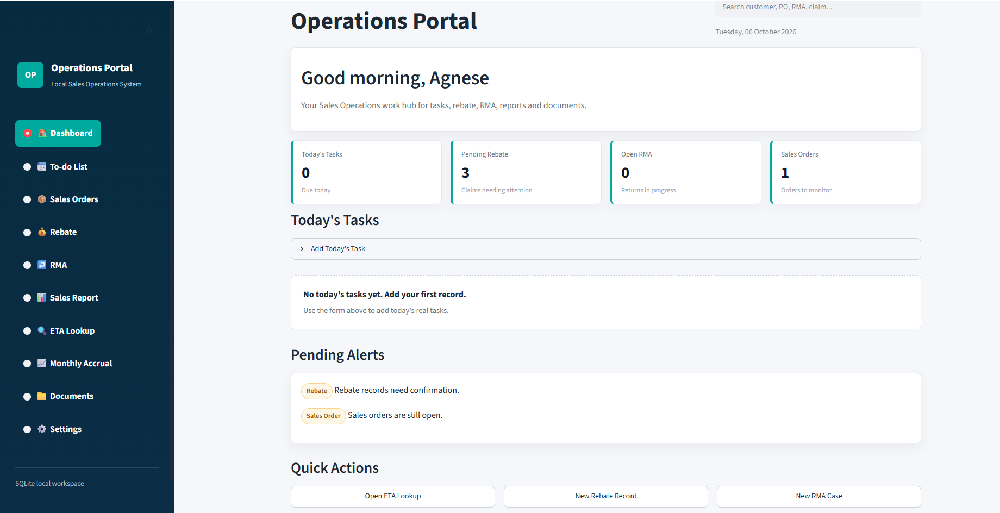
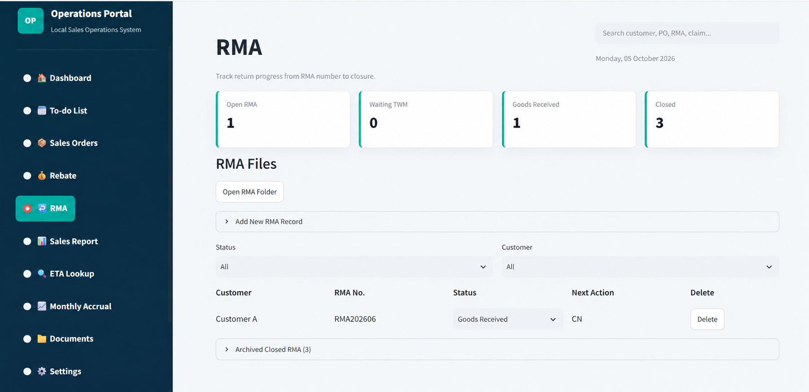
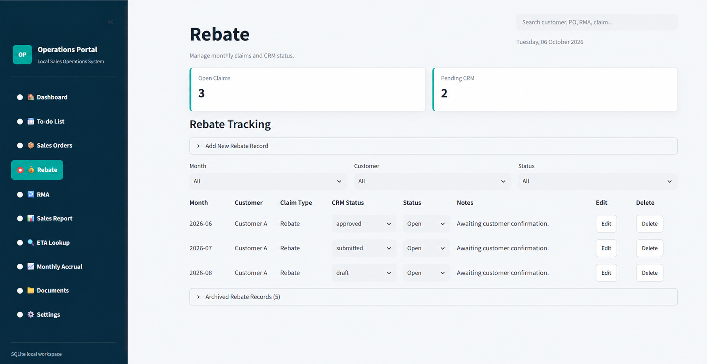
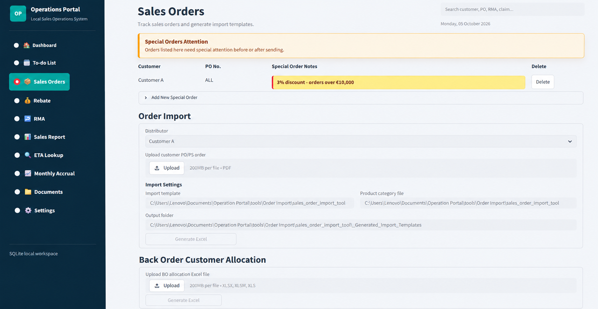
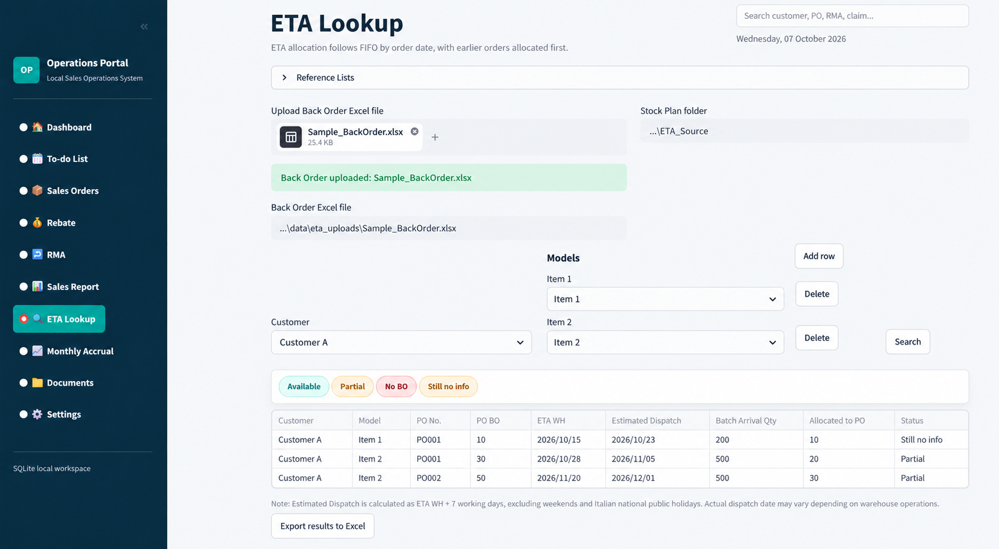
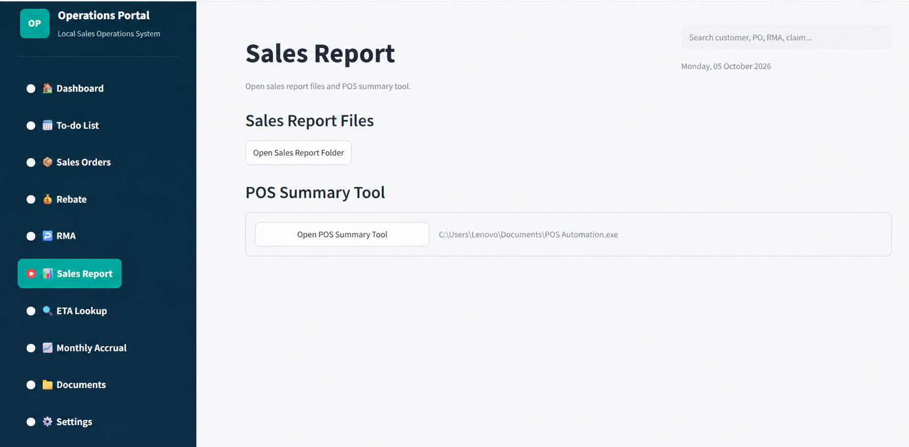
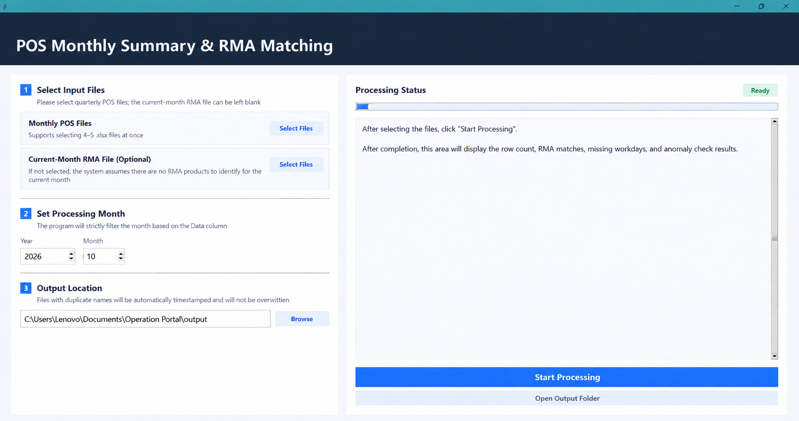
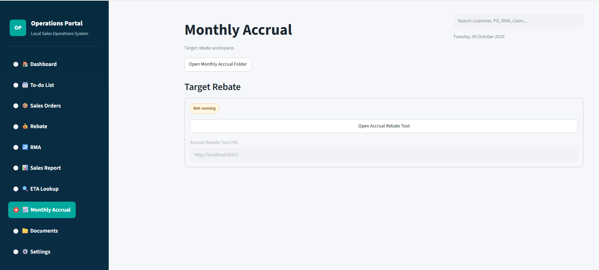
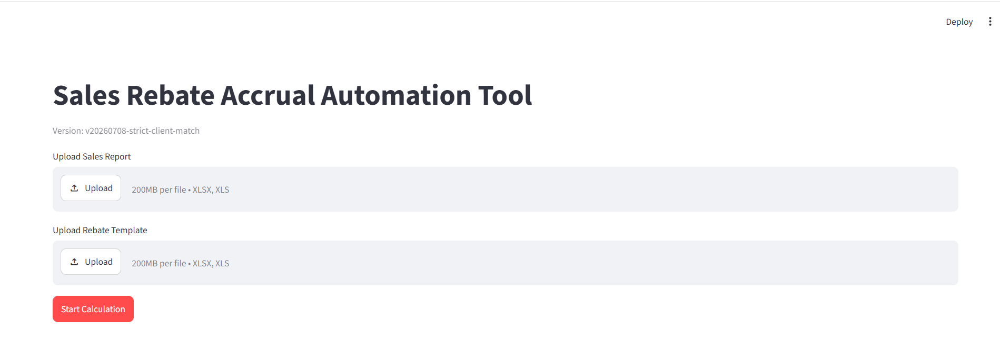

# Operations Portal

### Personal Sales Operations Productivity & Automation Workspace

A personal workspace I built to centralize recurring Sales Operations activities and automate repetitive workflows across order processing, reporting, ETA lookup, RMA tracking, and rebate accrual preparation.

> **Confidentiality notice:** Screenshots shown in this repository have been anonymized or use synthetic data. No confidential company, customer, pricing, or operational data is included.

---
## 📌 Overview

#### The Problem

Daily Sales Operations work often involves repetitive Excel processing, cross-checking data across multiple files, tracking pending items, and repeating the same preparation, matching, and validation steps. I initially built several standalone tools to automate specific workflows, but as these tools grew, I needed a more unified way to access and manage them.

#### The Solution

Operations Portal brings these workflows together in one workspace by combining embedded automation with the desktop and Streamlit tools I developed, while keeping each tool modular and focused on a specific operational need.

## 🎯 What This Improves

| Manual Work | With Operations Portal |
|---|---|
| Prepare sales order import files manually | Generate standardized order import files through embedded automation |
| Allocate Back Orders using repeated Excel manipulation | Process customer BO allocation through a dedicated workflow |
| Cross-check Back Order and stock-planning files for ETA | Retrieve ETA and allocation results through a customer/model lookup |
| Consolidate recurring sales reports manually | Process and consolidate multiple sales report files with a dedicated desktop tool |
| Match RMA records during monthly reporting | Automate RMA matching and validation during report processing |
| Calculate monthly rebate accruals manually | Process sales data and rebate rules through a dedicated Streamlit tool |
| Track tasks, RMA and rebate status in separate files | Manage recurring operational tracking in one workspace |

## 🧩 System Structure

Different tools within the operations Portal remain technically independent while still being accessible through one common interface.

```
Operations Portal
│
├── Workspace
│   ├── Dashboard
│   ├── To-do List
│   └── RMA Tracking
│   └── Rebate Tracking
│
├── Sales Order Processing [Embedded Automation]
│   ├── Order Import
│   └── Back Order Allocation
│
├── ETA Lookup [Embedded Automation]
│
├── Sales Report Processing & Consolidation [Desktop Tool]
│
└── Monthly Rebate Accrual [Streamlit Tool]
```
---

## 🗂️ Main Workspace

The dashboard provides a central view of tasks, pending activities, sales orders, RMA cases, reports, and frequently used tools.



### 1. To-do List 

The built-in task workspace is used to track daily, monthly, and general operational activities.

### 2. RMA Tracking

The RMA Tracking workspace centralizes return-case monitoring, making it easier to follow status, next actions, and closed records without maintaining a separate tracker.



### 3. Rebate Tracking

The Rebate Tracking workspace is used to monitor monthly rebate claims and CRM progress, providing visibility into open items, submission status, customer follow-up, and archived records.



---

## ⚙️ Core Automation Workflows

### 1. Sales Order Processing

The Sales Order section contains two embedded automation tools: Order Import and Back Order Customer Allocation.



#### Order Import

Transforms customer order information into a standardized import structure.

```
Customer Order
        ↓
Order Import
        ↓
Product mapping / categorization
        ↓
Validation
        ↓
Standardized Excel import template
```

The tool is designed to reduce repetitive manual preparation when processing customer orders.

#### Back Order Customer Allocation

Extracts allocation results for assigned customers from a centrally prepared Back Order allocation summary and generates a standardized customer-specific output.

### 2. ETA Lookup

The ETA Lookup tool combines Back Order information with stock-planning data to provide item-level availability, warehouse ETA, allocation visibility, and estimated dispatch visibility.

Stock arrivals are allocated to open orders using FIFO (First-In, First-Out) based on order date, prioritizing earlier orders. The tool then calculates the Estimated Dispatch date as Warehouse ETA + 7 working days, automatically excluding weekends and Italian national public holidays retrieved via a public holiday API. 

The tool applies the following allocation and dispatch calculation logic:
```
Back Order Data
        +
Stock Planning Data
        ↓
Match Customer / Model / Open PO
        ↓
Sort Open Orders by Order Date
        ↓
FIFO Stock Allocation
        ↓
Determine Allocation Status
        ↓
Warehouse ETA
        ↓
+ 7 Working Days
(excluding weekends and Italian public holidays)
        ↓
Estimated Dispatch Date
```



This reduces the need to manually cross-reference multiple source files when checking availability.

### 3. Sales Report Processing & Consolidation

Portal Entry Point:



The Sales Report section provides centralized access to recurring sales reporting files and launches a dedicated processing application.

Processing Tool:



The standalone tool processes and consolidates multiple sales report files, performs RMA matching, and applies validation checks before generating standardized monthly outputs.

Key functions include:
- Processing multiple sales report files at once
- Consolidating recurring sales data
- Matching current-month RMA records
- Checking data consistency
- Identifying missing or abnormal records
- Generating standardized output files
  
The goal is to reduce repetitive manual Excel work and make monthly sales reporting more consistent, reliable, and repeatable.

### 4. Monthly Rebate Accrual

Portal Entry Point:



The Monthly Accrual workspace provides access to a dedicated Streamlit-based rebate calculation tool.

Rebate Accrual Tool:



The tool combines sales data with a custom rebate template that I designed to encode customer-specific rebate rules, matching conditions, and calculation logic for monthly accrual preparation.

The tool applies the following workflow:

```
Sales Report
      +
Custom Rebate Template
(Customer Rules / Matching Logic / Calculation Logic)
      ↓
Customer / Rule Matching
      ↓
Validation
      ↓
Automated Rebate Calculation
      ↓
Monthly Accrual Output
```
The rebate template and underlying business logic were designed around the actual accrual workflow, allowing complex rebate conditions to be handled consistently through a repeatable process.

The goal is to reduce repetitive manual calculation and standardize monthly rebate accrual preparation.

## 💡 Project Evolution

The project evolved progressively from real day-to-day Sales Operations needs.

I first developed individual tools to automate specific repetitive tasks. As these workflows expanded, I integrated them into a common workspace while keeping each tool modular and focused on a specific operational purpose.

The result is a personal Sales Operations system that reduces repetitive manual work, standardizes recurring processes, improves access to operational information, and brings multiple automation workflows into one workspace.

## 🛠️ Development Approach

This project was developed using an **AI-assisted workflow with Codex**.

I defined the operational problems, workflow requirements, business rules, input/output logic, and overall system structure, then iteratively tested and refined the tools against real Sales Operations use cases.

Codex supported implementation, debugging, refactoring, and interface development, while the workflow design, validation criteria, and functional decisions were driven by my own operational requirements.
